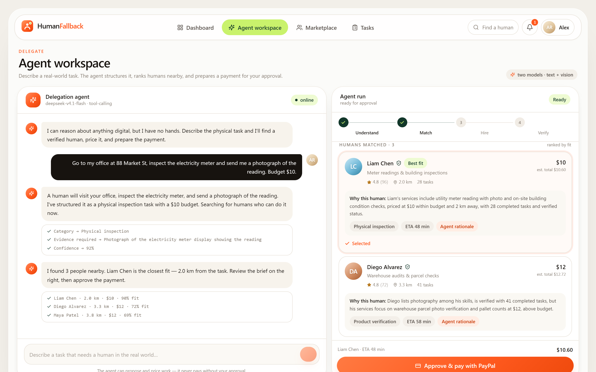
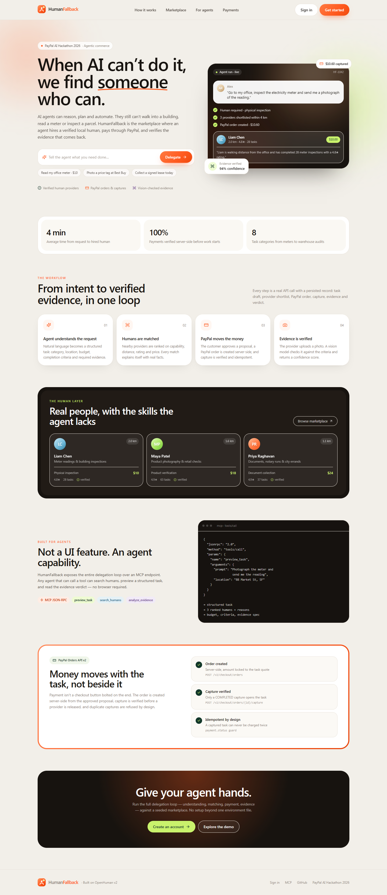
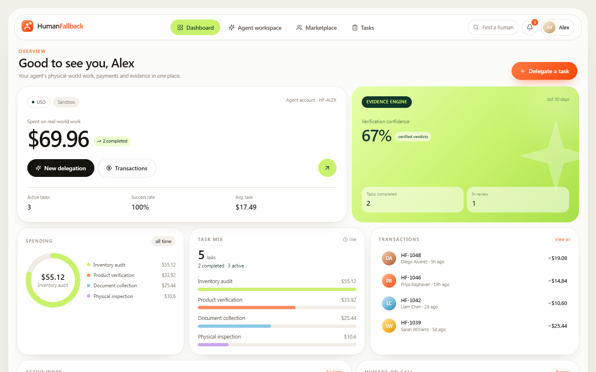
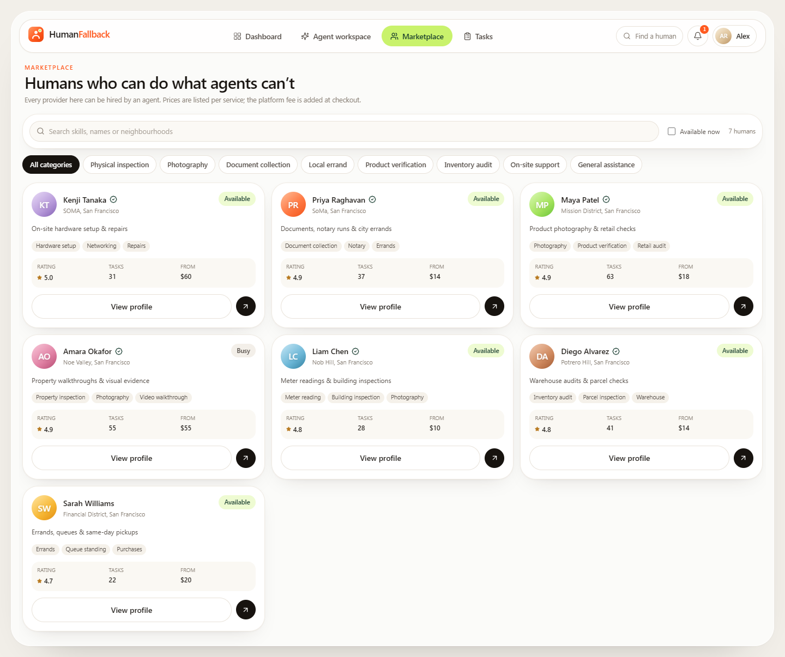
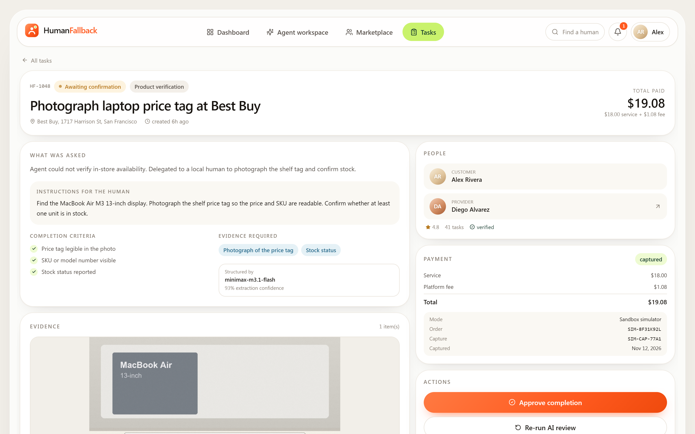
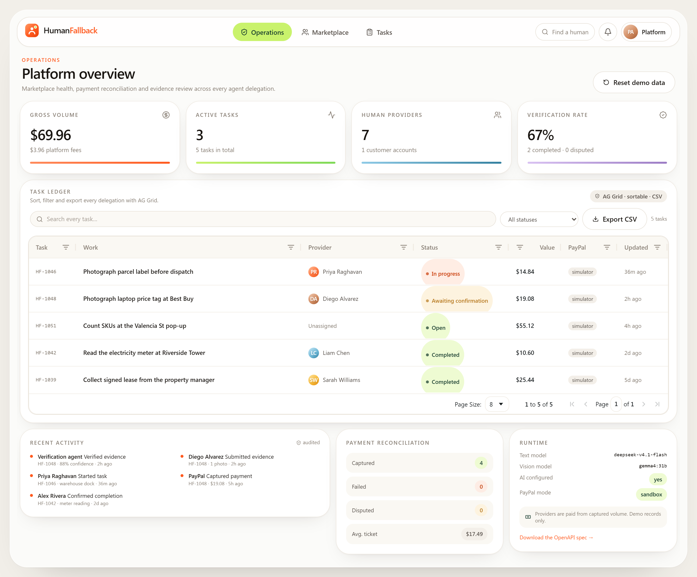

# HumanFallback

**The human workforce for AI agents.**

When an AI agent reaches the edge of what it can do — it has no hands, no legs, no badge for
the utility room — HumanFallback lets it hire a verified human, pay them through PayPal, and
verify the evidence that comes back.

> **PayPal AI Hackathon 2026** — Agentic Commerce track.

---

## The problem

Agents can now plan, research, write and automate almost anything digital. The moment a task
needs physical presence — read a meter, photograph a parcel, collect a signed lease, check a
shelf — the agent stops and hands the problem back to its user.

## The product

HumanFallback is a marketplace of verified humans that an agent can call like any other tool.
A request becomes a structured task, a shortlist of nearby humans, a PayPal order, and finally
a vision-checked evidence verdict.

The differentiator is not the marketplace. It is the **delegation loop**:

1. **Understand** — natural language → structured task (category, budget, criteria, evidence).
2. **Match** — providers ranked on capability, distance, rating, price and volume.
3. **Pay** — a PayPal order is created server-side from the approved proposal; the task is
   released only after the capture is verified.
4. **Verify** — the provider uploads a photo; a multimodal model checks it against the
   completion criteria and returns a verdict + confidence. A human still confirms.

## Screens



<p align="center">
  
  
</p>
<p align="center">
  
  
</p>



---

## Quick start

```bash
git clone <your-fork-url> humanfallback
cd humanfallback
npm install
cp .env.example .env.local      # add OLLAMA_API_KEY (and PayPal keys if you have them)
npm run dev                     # http://localhost:3000
```

The database seeds itself on first launch. No Postgres, no Firebase, no Docker required.

### Demo accounts

| Role | Email | Password |
|---|---|---|
| Customer (runs the agent) | `alex@humanfallback.ai` | `demo1234` |
| Human provider | `priya@humanfallback.ai` | `demo1234` |
| Platform admin | `admin@humanfallback.ai` | `demo1234` |

The sign-in screen also has one-click buttons for each role.

### Environment

| Variable | Purpose |
|---|---|
| `OLLAMA_API_KEY` | Ollama Cloud key (OpenAI-compatible). Without it the app falls back to a deterministic engine so the flow still works. |
| `OLLAMA_TEXT_MODEL` | Task understanding + matching rationale. Default `deepseek-v4.1-flash`. |
| `OLLAMA_VISION_MODEL` | Evidence verification. Default `gemma4:31b`. |
| `OLLAMA_BASE_URL` | Default `https://ollama.com`. Point at `http://localhost:11434` for a local daemon. |
| `PAYPAL_CLIENT_ID` / `PAYPAL_CLIENT_SECRET` | PayPal **Sandbox** REST app credentials. |
| `PAYPAL_ENV` | `sandbox` (default) or `live`. |
| `SESSION_SECRET` | HMAC key for the session cookie. Change it in production. |
| `HF_DATA_DIR` | Where the JSON store and uploads live. Default `./data`. |

If the PayPal keys are absent, checkout runs through a clearly-labelled **sandbox simulator**
that produces the same order/capture records. Nothing pretends to be a live charge.

### PayPal Sandbox buyer

With Sandbox keys configured, approving a proposal sends the browser to PayPal’s hosted
checkout. Sign in with a **Sandbox → Personal** account (developer.paypal.com → Testing Tools →
Sandbox Accounts), approve, and PayPal returns you to `/tasks/{id}?paypal=return`, where the
server verifies and captures the order before releasing the task to the provider.

---

## The demo flow (what judges should try)

1. Sign in as **Alex** → **Agent workspace**.
2. Type: *“Go to my office, inspect the electricity meter and send me a photograph of the
   reading. Budget $10.”*
3. Watch the agent extract the task, then rank three humans with factual reasons.
4. Edit the brief if you like (title, category, budget, location) → **Re-run matching**.
5. Select a provider → **Approve & pay with PayPal** → **Pay**.
6. Sign out, sign in as **Priya** → **Provider desk** → open the task → **Accept** → **Start**.
7. Upload a real photo from your phone with a short note → the vision model verifies it.
8. Sign back in as **Alex** → open the task → review the verdict → **Approve completion**.
9. **Transactions** shows the order ID, capture ID, fee and status.

> Tip: the verification model is deliberately strict. A synthetic or unrelated image will be
> rejected — use a real photo of the object for the happy path.

---

## Architecture

```
┌─────────────────┐        ┌──────────────────────────────┐
│  Agent workspace │──────▶│  /api/agent/parse            │  task understanding
│  (Next.js RSC)   │──────▶│  /api/agent/match            │  shortlist + rationale
└─────────────────┘        ├──────────────────────────────┤
        │                  │  /api/tasks                  │  draft + quote
        │                  │  /api/tasks/:id/pay          │  PayPal order
        │                  │  /api/tasks/:id/capture      │  verified capture
        │                  │  /api/tasks/:id/evidence     │  upload
        │                  │  /api/tasks/:id/verify       │  vision verdict
        │                  ├──────────────────────────────┤
┌─────────────────┐        │  /api/mcp                    │  JSON-RPC tool surface
│ Provider desk   │──────▶│  /api/humans, /api/stats     │
└─────────────────┘        └──────────────┬───────────────┘
                                          │
                              ┌───────────▼───────────┐
                              │  data/db.json         │  seeded document store
                              │  data/uploads/*       │  evidence files
                              └───────────────────────┘
```

- **Runtime store** — a JSON document store with an in-process cache and atomic writes. It keeps
  the demo zero-dependency while preserving every record. Swap `lib/store.ts` for Postgres and
  nothing else changes.
- **Auth** — scrypt password hashes, HMAC-signed httpOnly session cookie, role checks on every
  route (`customer`, `provider`, `admin`).
- **Money** — `lib/payments.ts` implements PayPal Orders v2 (`create` → `capture`). Simulator and
  live paths share one interface; the UI reads `/api/paypal/config` to label the mode honestly.
- **AI** — `lib/ai/ollama.ts` (chat + JSON extraction + retry) and `lib/ai/agents.ts` (task
  understanding, match rationale, evidence verification). Provider facts are computed
  deterministically; the model only writes narrative and verdicts from supplied data.

### Why the model can’t invent providers

Ranking is arithmetic in `lib/matching.ts` — capability, proximity, rating, price fit, volume,
verification. The LLM receives that shortlist and is instructed to explain it using only those
facts. Scores and distances in the UI come from the deterministic layer, not the model.

---

## PayPal integration details

| Concern | Implementation |
|---|---|
| Order creation | `POST /v2/checkout/orders` with `intent: CAPTURE`, amount fixed to the task quote |
| Approval | `approve` link returned when live; the simulator shows an in-app checkout sheet |
| Capture | `POST /v2/checkout/orders/{id}/capture`; only a `COMPLETED` capture opens the task |
| Idempotency | `payment.status === "captured"` returns the existing capture, never a second charge |
| Server-side only | Credentials never reach the browser; `/api/paypal/config` returns the client ID only |
| Audit | `transactions[]`, `payment.*`, and `activity[]` records carry order/capture IDs |
| Failure | A failed capture marks the payment `failed` and the task never reaches the provider |

**Honest scope:** the demo does not claim escrow, automatic disbursement or worker payouts. It
collects the approved amount as the marketplace operator and records the provider’s payable
balance. Real payouts need a supported PayPal payout arrangement.

---

## MCP (agent-to-marketplace)

Any agent can call the marketplace over JSON-RPC:

```bash
curl -s http://localhost:3000/api/mcp \
  -H 'Content-Type: application/json' \
  -d '{"jsonrpc":"2.0","id":1,"method":"tools/call",
       "params":{"name":"preview_task",
                 "arguments":{"prompt":"Photograph the meter and send me the reading"}}}'
```

Tools: `search_humans`, `preview_task`, `get_task`, `analyze_evidence`. `initialize` and
`tools/list` are implemented for MCP clients.

## API contract (OpenAPI) and APIMatic

The whole REST surface is described in [`openapi/humanfallback.yaml`](openapi/humanfallback.yaml)
(OpenAPI 3.1) and served live at **`/api/openapi`**.

That single contract is the source for SDKs, docs and agent tooling:

```bash
npm run apimatic:validate   # APIMatic spec validation
npm run apimatic:sdk        # TypeScript SDK -> ./sdk
npm run apimatic:portal     # API documentation portal -> ./portal
```

The APIMatic CLI needs a free APIMatic account (`apimatic auth login`, or `--auth-key`) before
running the generators. The build input lives in [`apimatic/`](apimatic/) and the generated
TypeScript client is committed at [`sdk/`](sdk/) — 160 files of typed client, models and docs,
produced by APIMatic from the contract with no hand edits.

### AG Grid

The operations ledger in `/admin` is a real AG Grid — quick filter, per-column filters, sorting,
pagination, CSV export (`exportDataAsCsv`) and React cell renderers for status pills, provider
avatars and money. It is themed with the Quartz Theming API to match the rest of the product, and
it is the screen we use to reconcile every task against its payment.

---

## Project layout

```
app/
  page.tsx                  landing
  (app)/dashboard           customer overview
  (app)/workspace           the agent experience
  (app)/marketplace         humans + filters
  (app)/humans/[id]         provider profile
  (app)/tasks, tasks/[id]   lifecycle, evidence, verification
  (app)/provider            provider desk
  (app)/transactions        PayPal records
  (app)/admin               operations + reconciliation
  api/…                     REST + MCP
lib/
  ai/                       model client + agents
  store.ts, seed.ts         runtime store + demo data
  payments.ts               PayPal Orders v2
  matching.ts               deterministic ranking
  tasks.ts                  lifecycle rules
components/                 design system + feature UI
```

---

## Design

Warm neutral canvas, white cards with large radii, a coral gradient for actions and a lime accent
for money states. Every screen is responsive from 375 px up, keyboard accessible, and uses no
external images — avatars are generated gradients, evidence photos ship with the repo.

---

## Limitations

- Single-process JSON store: fine for a demo, not for concurrent production traffic.
- Vision verification is advisory by design; completion is always human-confirmed.
- Provider payouts are recorded, not transferred.
- The seed marketplace is fictional (San Francisco) and intentionally small.

## License

MIT — see [LICENSE](./LICENSE).
